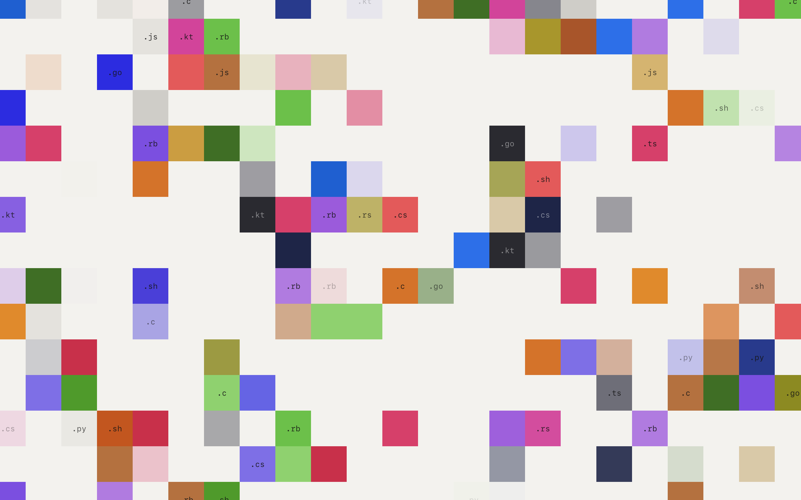
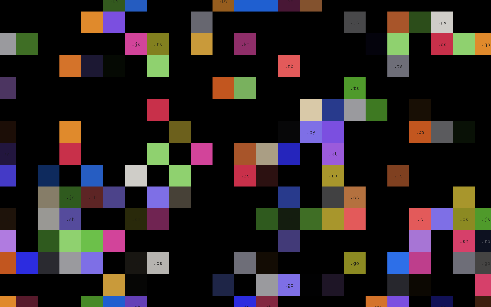
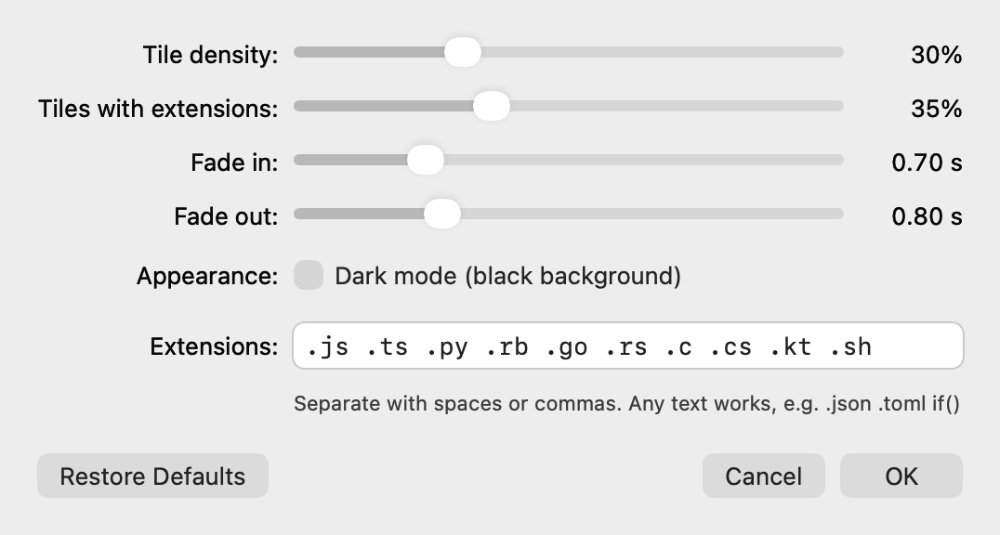

# Code Tiles

A macOS screen saver of coloured tiles that fade in and out on a square grid. Some tiles carry a programming file extension (`.js`, `.py`, `.rs`, …), the rest are blank.





## Features

- Tiles appear and disappear at random, each on its own timer, and tend to grow in small clusters.
- Default fade timings were measured frame by frame from reference footage (fade in 0.7 s, fade out 0.8 s).
- Labels linger slightly as a tile fades, leaving faint "ghost" text.
- Light (off-white) or dark (black) background.
- Everything is adjustable from the screen saver's Options panel.
- Universal binary for Apple Silicon and Intel Macs; animation runs on Core Animation, so CPU use stays negligible even on 5K displays.

## Install

Requires macOS 12 Monterey or later, on Apple Silicon or Intel.

1. Download `CodeTiles-<version>.pkg` from the [latest release](https://github.com/charlie-f/codetiles/releases/latest).
2. Open it and follow the installer. Choose *Install for me only* to skip the admin password.
3. Open **System Settings → Screen Saver**, choose **Code Tiles** under *Other*, and click **Options…** to adjust it.

The installer is signed with a Developer ID and notarized by Apple.

## Build from source

Needs Xcode or the Xcode Command Line Tools (`xcode-select --install`).

```bash
git clone https://github.com/charlie-f/codetiles.git
cd codetiles/macOS
./build.sh install
```

`./build.sh` on its own builds `macOS/build/CodeTiles.saver` without installing it. `install` copies it to `~/Library/Screen Savers` and restarts the macOS screen saver host so the new build is picked up. A build made this way is ad-hoc signed, so it runs on the Mac that built it but not on other Macs.

## Options



| Setting | Range | Default | What it does |
| --- | --- | --- | --- |
| Tile density | 5–90% | 30% | Share of grid cells showing a tile at any moment |
| Tiles with extensions | 0–100% | 35% | Share of tiles that carry a label; the rest are blank |
| Fade in | 0.05–3 s | 0.70 s | How long a tile takes to appear |
| Fade out | 0.05–3 s | 0.80 s | How long a tile takes to disappear |
| Appearance | on / off | off | Dark mode: black background instead of off-white |
| Extensions | up to 64 | `.js .ts .py .rb .go .rs .c .cs .kt .sh` | Labels to show, separated by spaces or commas. Any text works, e.g. `.json .toml if()` |

**Restore Defaults** resets every option.

## Uninstall

Delete `CodeTiles.saver` from whichever folder it was installed to:

```bash
rm -rf ~/Library/Screen\ Savers/CodeTiles.saver
```
```bash
sudo rm -rf /Library/Screen\ Savers/CodeTiles.saver
```

The first is a *for me only* install (or `./build.sh install`); the second is an install for all users.

## Making a release

1. Bump `CFBundleShortVersionString` and `CFBundleVersion` in `macOS/Info.plist`.
2. Build the signed, notarized installer:

   ```bash
   cd macOS
   ./package.sh --release
   ```

   This needs, in your login keychain, a *Developer ID Application* and a *Developer ID Installer* certificate, plus notarization credentials saved once with:

   ```bash
   xcrun notarytool store-credentials codetiles-notary --apple-id <your Apple ID> --team-id <your Team ID>
   ```

3. Publish it:

   ```bash
   gh release create v<version> dist/CodeTiles-<version>.pkg --title "Code Tiles <version>" --generate-notes
   ```

`./package.sh` without `--release` makes an unsigned installer for local testing only.

## Notes

- macOS runs the System Settings preview and the real screen saver in a shared `legacyScreenSaver` process, and the Options panel in another one. Code Tiles never quits that process itself, reads its settings fresh rather than from a cache, and broadcasts a notification when they change so every running copy updates at once.
- The installer restarts System Settings and the screen saver host so an upgrade takes effect immediately; leaving System Settings attached to a restarted host is what breaks the Options button.
- Code Tiles logs its lifecycle under the subsystem `com.charlie.CodeTiles`. To see what it did:

  ```bash
  /usr/bin/log show --last 10m --predicate 'subsystem == "com.charlie.CodeTiles"'
  ```

## Project layout

```
macOS/
  build.sh                 build, sign and optionally install
  package.sh               build the .pkg installer (signed and notarized with --release)
  Info.plist               bundle metadata
  Resources/               thumbnails shown in System Settings
  Sources/
    CodeTilesView.swift    grid, tile lifecycle and animation
    ConfigController.swift Options panel
    Settings.swift         saved preferences and defaults
    Palette.swift          tile and background colours
docs/                      README images
```

A Windows version is planned.

## License

[MIT](LICENSE)
